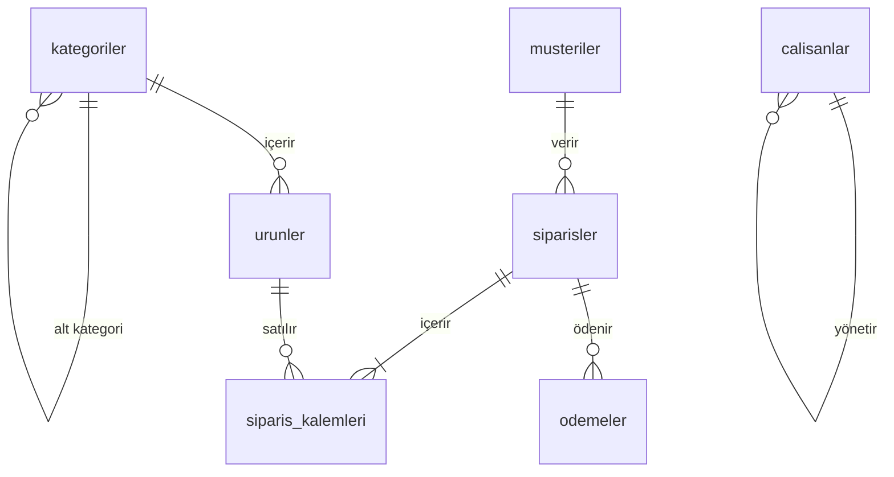

# Örnek veritabanı

Repodaki bütün sorular aynı küçük e-ticaret veritabanı üzerinde. Bir online mağaza düşün: müşteriler sipariş veriyor, siparişlerin içinde ürünler var, ödemeler alınıyor. Bunların yanında bir de şirketin kendi çalışanlarının tutulduğu ayrı bir tablo var.

Her soruda yeni bir tablo öğrenmek yerine aynı şemayı iyice tanıman için böyle yaptım. Mülakatta da genelde birkaç tabloluk bir senaryo verilir, bu yüzden alışkanlık yapması işine yarar.

## Tablolar arası ilişkiler



## Tablolar

| Tablo | Satır | Ne tutuyor |
|---|---|---|
| `kategoriler` | 18 | Ürün kategorileri. `ust_kategori_id` ile kendi kendine bağlı (Elektronik > Telefon gibi). |
| `musteriler` | 200 | Ad, soyad, e-posta, şehir, doğum ve kayıt tarihi. |
| `urunler` | 50 | Fiyat, stok, aktif mi değil mi. Her ürün bir (alt) kategoriye bağlı. |
| `siparisler` | 1000 | Hangi müşteri, ne zaman, hangi durumda (`beklemede`, `kargoda`, `tamamlandi`, `iptal`, `iade`). Varsa kupon kodu. |
| `siparis_kalemleri` | 2500 | Siparişin içindeki ürünler. Adet ve **satış anındaki** `birim_fiyat`. |
| `odemeler` | 962 | Ödeme tutarı, yöntemi (`kredi_karti`, `havale`, `kapida_odeme`) ve tarihi. |
| `calisanlar` | 15 | Şirket çalışanları. `yonetici_id` ile kendi tablosuna bağlı, self join için. |

Tablo ve kolon adlarında bilerek Türkçe karakter kullanmadım (`musteriler`, `siparis_tarihi`...). Böylece sorgu yazarken tırnak işaretiyle uğraşmıyorsun. Verinin içinde ise normal Türkçe karakterler var (`İstanbul`, `Şahin`).

## Veride bilerek bıraktığım ayrıntılar

Gerçek veri temiz olmaz, mülakat soruları da çoğunlukla bu pürüzlere takılır. O yüzden şunlar var:

- 8 müşterinin şehri, 11 müşterinin doğum tarihi boş (`NULL`).
- 20 müşteri hiç sipariş vermemiş. `LEFT JOIN` ve `NOT EXISTS` soruları için.
- `47`, `48`, `49`, `50` numaralı ürünler hiç satılmamış.
- 6 kategoride doğrudan ürün yok: beş ana kategori (ürünler alt kategorilere bağlı) ve `Dekorasyon`.
- 97 sipariş `iptal`, 49 sipariş `iade`, 10 sipariş `beklemede`, 10 sipariş `kargoda`. İptal ve beklemedeki siparişlerin ödemesi yok.
- 69 siparişte ödeme iki parçaya bölünmüş. Siparişin tutarını bulmak için ödemeleri toplaman gerekiyor.
- 278 kalemde `birim_fiyat`, ürünün şimdiki `fiyat` değerinden %10 düşük. Yani bir siparişin toplamını `urunler.fiyat` ile hesaplarsan yanlış çıkar, doğrusu `siparis_kalemleri.birim_fiyat`.
- En çok adet satan ürün (`Atlama İpi`) ile en çok ciro yapan ürün (`Dizüstü Bilgisayar`) farklı.
- Siparişler yıl boyunca artıyor: ocakta 46, aralıkta 104 sipariş var. Aylık karşılaştırma soruları için.
- `calisanlar` tablosunda 10 ve 11 numaralı iki kişinin maaşı aynı. `RANK` ile `DENSE_RANK` arasındaki farkı göstermek için.
- Bazı çalışanlar kendi yöneticisinden fazla kazanıyor. Self join sorularının boş sonuç döndürmemesi için.

## Bilmen gerekenler

**Tarihler sabit.** Siparişler 2024 yılında, müşteri kayıtları 2022-2023'te. "Son 30 gün" gibi bir şey sorulduğunda `CURRENT_DATE` kullanma, soruda verilen tarihi yaz. Yoksa sonuç sen çalıştırdığın güne göre değişir.

**Veri her makinede aynı.** Hiçbir yerde `random()` kullanmadım, veri formüllerle üretiliyor. Sorulardaki beklenen satır sayıları bu yüzden herkeste tutuyor.

**Foreign key kolonlarında index yok.** PostgreSQL, foreign key tanımlayınca otomatik index açmaz. `siparisler.musteri_id` gibi kolonlar bilerek indexsiz bırakıldı, index modülünde bunun farkını kendin göreceksin.

## Veritabanını sıfırlamak

Bir şeyleri bozduysan ya da silip baştan başlamak istersen:

```bash
docker compose down -v
docker compose up -d
```

Docker kullanmıyorsan, kendi PostgreSQL'inde `eticaret` adında bir veritabanı açıp iki dosyayı sırayla çalıştırman yeterli. `01_sema.sql` tabloları silip yeniden oluşturduğu için aynı komutla istediğin kadar sıfırlayabilirsin:

```bash
psql -d eticaret -f db/01_sema.sql -f db/02_veri.sql
```
